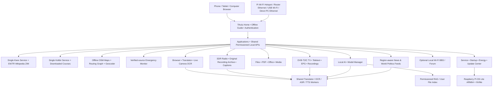

# Tihulu Survival Kit — Feature Scope and System Architecture

> **Public project status (November 5, 2026):** This document describes **intended capabilities and early experiments**, not a complete working product. There is **no released, verified Tihulu installation image or functioning production portal**. An experimental Stage 4 service/task manager exists in a separate [draft PR #1](https://github.com/Tihulu/tihulu-survival-kit/pull/1); this is **not** evidence of a deployed appliance. No radio signal, DVB TV, satellite/emergency-alert receiver, on-device AI performance or antenna coverage is guaranteed. **Design approval and shipping software are separate milestones.**

## What is Tihulu?

**Tihulu Survival Kit** is a planned **offline-first, portable knowledge, education, preparedness, mapping and local-AI platform** built around a Raspberry Pi 5 with a shared local web interface. Once its applications and data are installed, it should provide previously downloaded archives, maps, courses, files and AI models without a WAN connection, while letting an authorized user selectively update content and alert sources when internet access is available.

Tihulu aims to preserve useful capabilities from **HAS Prepper Disk** and **Internet-in-a-Box (IIAB)** and selected original offline resources, while adapting appropriate **Project NOMAD** utilities to Raspberry Pi 5 / ARM64 constraints. No blindly copied x86-64 containers or assumptions of already bundled packages. Upstream licenses, content origins, packaging, and resource sharing require individual verification.

## Target device

- **Raspberry Pi 5 with 8 GB RAM**; other main-device models are not the validated target.
- Compatible NVMe/PCIe/M.2 HAT with approximately **1 TB NVMe** storage; Acer FA100 is a design example, not an approved boot configuration.
- Active cooling and a Pi 5-compatible USB-C supply, or a measured suitable powerbank.
- Built-in Wi-Fi operating as the proposed **Tihulu Kit** hotspot; optional second USB Wi-Fi adapter as a home-router client, plus Ethernet to router or directly to PC.
- Optional **receive-only USB SDR**, e.g. the NooElec NESDR SMArt v5 candidate; antenna, frequency coverage, usable reception, power and legal constraints must be tested.
- Separately, a **Hauppauge WinTV-soloHD EU 01589 DVB-T/T2/C tuner** was reported purchased, along with a TV antenna. Its physical delivery, Pi5 drivers, firmware, reception and HEVC playback remain **unverified**. It is not an SDR or transmitter.
- Access is intended from browsers on phones, tablets and computers; a full Linux graphical desktop on the Pi is **not** required.

## Target architecture

The future applications should share **authenticated access, installation state, worker lifecycle, local files and permissions, update sources, per-user job state and low-RAM policies**. Avoid needlessly launching a second Kiwix/Kolibri instance or multiple heavyweight LLM/Translator workers for separate tabs. Nothing in this diagram implies that the listed services are installed.

## Planned modules

| Application | Intended user value | Key constraints / permissions |
|---|---|---|
| **Home & Offline Guide** | First boot, access paths, settings, application list, connectivity and troubleshooting | Mobile, tablet and desktop access; local owner authentication |
| **Kiwix / HAS / IIAB** | Original full English/Turkish Wikipedia editions, selected survival, medical/reference and repair archives | Download large ZIMs separately; real edition, manifest and provenance; one shared server |
| **Kolibri / Learning** | Locally available educational courses and video, progress tracking | Permitted content packs, real per-user progress |
| **Maps & Offline Navigation** | Region-specific OSM maps, user-approved GPS, A-to-B walking/driving/cycling routes | Tiles are not a route engine; real routing graph, geocoder/POIs and HTTPS/device permission required |
| **Emergency Monitor** | Region/country/global-important alerts from actual official sources | Target coverage of 24 countries/areas; source freshness and scope may vary; monitoring requires explicit opt-in |
| **Local AI & RAG** | Light/Balanced/experimental Maximum profiles, cited document answers, opt-in search of accessible user files | Measure on Pi5 8 GB; one heavyweight model at a time, authorized file/USB indexing only |
| **Hugging Face Model Manager** | Discover, download, uninstall or import compatible GGUF models | ARM64, source/license, exact size/hash, model RAM/context requirement and WAN permission |
| **Browser** | Ordinary online browsing, Kiwix/Kolibri and offline PDF access; translate-first AI summarization and Q&A | Real browser engine, multi-tab limits, isolation and permission validation |
| **Translator + Camera OCR** | Text/document translation, user-authorized phone-camera Live OCR, optional subsequent AI | Client camera requires trusted HTTPS/permission; model/language packs, load and data retention checked |
| **Radio / Subtitle Studio** | Listen through compatible SDR, record original streams, optionally ASR/translate into subtitles | Actual band/antenna/hardware compatibility, recording rules and measured latency |
| **Television / Teletext** | Regional German/Turkish TV channel directory, real DVB scan/manual tune, EPG, original captions, recorded/live translation | Separate DVB-T2 tuner; RF lock and stream availability, single-mux contention, content rights and HEVC decoding |
| **News & World Politics** | User-selected conventional, opposition, independent and party-operated news, politicians' verified official posts | Source identity/API access, editorial attribution, 24-hour text cache target, default background OFF |
| **Local Messaging / BBS** | Opt-in LAN-only forum/messages between connected authorized clients | Auth/ACL, storage retention and anti-abuse; no RF range without additional transmit-capable radio |
| **Files / USB / Nextcloud** | NVMe and attached USB file access; optional authorized Nextcloud/WebDAV sync | Explicitly approved folder scopes and credentials; no silent client-disk access |
| **PDF / Office / Media** | PDF viewing/OCR/translation, optional document editing, audio/video and SRT/VTT | Supported file formats/ARM64 backends must be verified; preserve user originals |
| **FlatNotes / CyberChef candidates** | Lightweight offline notes and local data analysis/encoding utilities | Upstream packaging/licensing and tested functionality |
| **Service / Startup / Energy / Memory** | Separate Hard/Background/Startup permissions, worker idle-stop, running task list, RAM and power visibility | Protected system core and Emergency consent; real measurements and safe job finalization |
| **Software & Update Center** | Version-aware updates, offline package imports, selected model/language/map/course/ZIM packs | Genuine source/version/size/checksum, consent, restore/rollback support |
| **Setup Wizard / Image Builder** | Quick/Standard/Advanced; Minimal Core, Full Offline, Custom/Hybrid and PC Complete | Not yet implemented; clearly distinguish installed versus planned packages |
| **Daily Discovery / Wiki Game** | Interesting daily article, survival tip, word and profanity/slang definition, offline Wikipedia A-to-B link challenge | Actually installed article/lexicon graph, attribution and language-pack availability |

## Scope and limitations of Emergency information

The currently proposed source coverage list is: **Germany, Turkey, United States, Iran, Greece, Bulgaria, United Kingdom, Netherlands, Belgium, Poland, Denmark, Greenland, France, China, Russia, Czechia, Austria, Switzerland, Luxembourg, Georgia, Armenia, Azerbaijan, Iraq and Syria**.

This list **does not imply** that a reliable, real-time, all-hazards **official API** exists for every country. The UI must display source, checked time, country/region coverage, whether a feed is offline/stale, and known gaps. With **Emergency Master OFF**, no new automatic alerts—including globally critical ones—should be claimed. Original audio from actually received, owner-authorized emergency radio recordings should be preserved, not replaced by transcripts or fabricated from text.

Tihulu cannot replace **official authorities, reliable emergency communications or emergency responders**.

## Live phone-camera OCR

The future **Camera → Live OCR** workflow requires a client action, selects a permitted camera and region of interest, periodically recognizes text, and optionally lets the user **Translate** or **Ask AI**. Source video/images are **not persistently recorded by default**; saving requires explicit permission. A Hard OFF OCR/Translator/AI service must **not** be enabled silently. See [Live OCR and Device Permissions](LIVE_OCR_AND_PERMISSIONS.md).

## First boot and network access

- Planned hotspot SSID **`Tihulu Kit`**, with a **unique owner-defined Wi-Fi passphrase not committed to GitHub**, and a separate administrator password.
- Proposed hotspot portal: **`tihulu.lan` / `10.10.10.10`** only once AP/DNS/portal services have been implemented.
- Router Ethernet and second USB Wi-Fi client should expose the same authenticated applications via **`tihulu.local`** when mDNS works or the Pi's actual router-assigned IP. `tihulu.lan` on the router requires its own local DNS alias.
- Direct Ethernet between PC and Pi is another possible interface. A computer may separately share internet via Windows ICS, macOS Internet Sharing or Linux NetworkManager. The cable alone does **not** supply internet.
- Device camera, microphone, GPS and client-file access require trusted browser security/HTTPS and explicit permissions. Mobile should support file/photo pickers, desktop drag/drop as authorized.

See [Network Access](NETWORK_ACCESS.md) and [Getting Started](START_HERE.md).

## Local AI model and service resource management

Raspberry Pi 5 has finite **8 GB physical RAM**. Tentative model classes:

- **Light:** approximately 1.5–2B parameters.
- **Balanced:** approximately 3–4B parameters.
- **Maximum:** approximately 8B, strictly experimental until proven.
- Candidate default system assistant is Light; chat may choose Balanced only if real Pi measurements support it. Keeping model files **on disk** does not require keeping inference workers always in RAM.
- If an installed worker is **Hard ON** it can be started for an explicit foreground task even when **Background OFF** or **Startup OFF**. When **Hard OFF**, offer **Enable for this task / Enable persistently / Continue without it** and retain the original stored preference.
- ASR and Translator may run on demand for radio/TV subtitles and then unload when unused. A recording, active job, hotspot or system-auth service must not be killed by an unrelated window closing or model memory pressure.
- A proposed **4 GiB zram and 8 GiB NVMe swapfile** would provide compressed/swap-backed **virtual memory**, **not 12 or 20 GB of physical RAM**; swapping introduces delay and storage wear considerations. These numbers remain a proposed configuration, not a benchmarked requirement.

## Shared frequency discovery across TV, Radio and Text/Data apps

The planned **Channel & Signal Explorer** provides multi-select published presets, owner-triggered DVB/SDR band scanning in bounded chunks, manual frequency and supported fine-tuning, categorized signal/decoded-service results, and a shared owner-scoped channel/favorites list. All findings must be attributed to an **actual connected receiver and timestamped backend**; published frequency catalog records and unclassified RF energy are not evidence of decoded programming. The purchased Hauppauge DVB-T2/C tuner is not an FM/DAB/HF/ham SDR. TV recordings must not be interrupted by retuning a different multiplex.

The **Text/Data Browser** separates one-way DVB Teletext navigation from ordinary interactive HTTPS Teletext-themed sites and authenticated packet BBS/forum services. Existing Tihulu Translator/Local AI workers process selected, authorized source text on demand and preserve originals. A website cannot be promised to embed if its security headers block framing; a real browser or external tab is required. Radio communication, if ever enabled, must use separate legal transmitter hardware. Current implementation is **experimental public draft-branch code**, not a delivered Pi interface.

## Region-aware TV, text and political feeds

- Initial Region Manager supports **16 German federal states** and **81 Turkish provinces**, with country/region selection separate from UI language and real broadcaster availability.
- Germany/Turkey directory may include public channels, private channels, and independently verified online feeds, but **a catalog entry is not proof of RF reception**.
- The purchased Hauppauge DVB tuner may expose **DVB Teletext, EPG/EIT and subtitle tracks** only where present in an actually received transport stream; **Teletext is one-way**. Separate radio hardware is needed for **RDS, DAB text/Journaline, APRS and actual two-way radio messaging**.
- News & Politics is intended to include diverse mainstream, independent/critical, opposition and party-published sources, plus verified public politician/institution accounts. Party declarations and politicians' claims must not be presented as independently fact-checked journalism.
- Draft news cache policy: **24 hours after publication, 30 MB total cache target, background refresh OFF by default**; this must never delete original recordings, private files, Emergency archives or user forum messages.

## Feature status and release rules

**Writing public documents or publishing a draft prototype is not completion of the product.** Once working installer, APIs, UI or Pi Core applications are actually merged and validated, update the status of each feature explicitly as **implemented / tested / experimental / planned**.

End-to-end validation should cover Pi5 power/cooling, secure NVMe boot and backups, hotspot/router/direct-PC access, HTTPS certificate trust, first-run setup, actual Wikipedia ZIMs, offline routing data, official Emergency sources, SDR and real broadcast recordings, local LLM memory/latency, camera OCR, and accurate privacy/retention behavior. Performance and safety claims must be based on **measured evidence**.

## Sources and acknowledgments

- [HAS Prepper Disk](https://github.com/schematrix/HAS_Prepper_Disk)
- [Internet-in-a-Box](https://internet-in-a-box.org/) / [IIAB GitHub](https://github.com/iiab/iiab)
- [Project NOMAD](https://github.com/Crosstalk-Solutions/project-nomad)
- [Kiwix](https://www.kiwix.org/) / [Kolibri](https://learningequality.org/kolibri/)
- [OpenStreetMap](https://www.openstreetmap.org/)
- [llama.cpp](https://github.com/ggml-org/llama.cpp)
- [Hugging Face GGUF](https://huggingface.co/docs/hub/gguf)
- [Raspberry Pi documentation](https://www.raspberrypi.com/documentation/)

## Guide directory

- [Getting Started](START_HERE.md)
- [Installation](INSTALLATION.md)
- [Network Access](NETWORK_ACCESS.md)
- [Live OCR and Device Permissions](LIVE_OCR_AND_PERMISSIONS.md)
- [Main README](../README.md)
- [Turkish translation](tr/FEATURES_AND_ARCHITECTURE.md)
