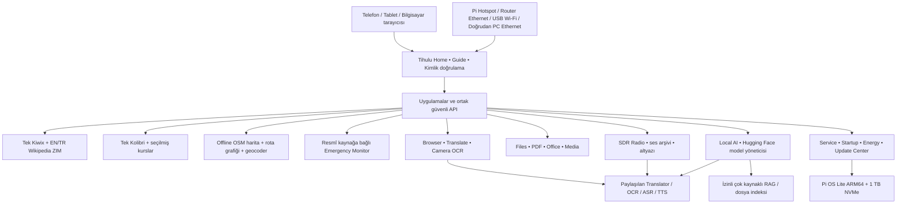

# Tihulu Survival Kit — Özellik Kapsamı ve Sistem Mimarisi

> **Kamuya açık ürün yönü / 5 Kasım 2026:** Bu belge uygulanması **planlanan** özellikleri anlatır. **Henüz çalışan uygulama, doğrulanmış kurulum imajı, donanım testi veya resmi yayın bulunmuyor.** Donanım performansı, yerel LLM hızları, anten kapsama alanı ve uydu/acil haber alımı garanti değildir. Tasarım kararlarının ve uygulamanın onayı birbirinden ayrıdır.

## Proje nedir?

**Tihulu Survival Kit**, Raspberry Pi 5 üzerinde çalışması hedeflenen **offline-first, taşınabilir, yerel web arayüzlü bir bilgi, eğitim, afet hazırlığı ve yerel AI platformudur**. İnternet hiç yokken de önceden indirilmiş bilgi arşivleri, haritalar, kurslar, dosyalar ve yerel modellerle çalışmayı amaçlar. İnternet varsa kullanıcı izniyle içerik/güncelleme/uyarı kaynaklarını yeniler.

Proje **HAS Prepper Disk** ve **Internet-in-a-Box (IIAB)** bilgi/öğrenim ekosisteminin işlevlerini ve ilgili orijinal içeriğini korumayı; **Project NOMAD**'dan uygun seçilmiş araçları ARM64/Raspberry Pi 5 koşullarına uyarlamayı amaçlar. Birebir x86-64 container aktarımı varsayılmaz; lisanslar, kaynaklar, entegrasyon ve tekil servisler doğrulanmalıdır.

## Önerilen cihaz

- Raspberry Pi 5 **8 GB** (başka modeller şu anda hedeflenmiyor).
- NVMe HAT/M.2 adaptörü; örnek **1 TB Acer FA100** NVMe, doğru boot ve enerji doğrulaması.
- Aktif soğutma, uygun USB-C güç kaynağı veya ölçülmüş uyumlu powerbank.
- Pi dahili Wi-Fi **Tihulu Kit** hotspot'u; ikinci USB Wi-Fi istemcisi ve Ethernet ile router/PC bağlantısı.
- İsteğe bağlı **USB receive-only SDR** (ör. NooElec NESDR SMArt v5 aday), anten ve ortam/erişim testleri.
- Telefon, tablet veya bilgisayar sadece tarayıcıdan erişir; Pi'de zorunlu grafik masaüstü planlanmıyor.

## Mimarinin hedefi

Uygulamalar ortak **kimlik doğrulama, servis başlatma/durdurma, dosya ve izinler, kaynak güncelleme, düşük RAM politikası** kullanacak; gereksiz ikinci Kiwix/Kolibri sunucusu veya paralel büyük LLM işçisi hedeflenmiyor.

## Planlanan modüller

| Bölüm / uygulama | Kullanıcıya sunacağı değer | Başlıca teknik ve izin koşulları |
|---|---|---|
| **Home & Guide** | İlk açılış, adresler, kurulum, uygulamalar, bağlantılar, hata giderme | Telefon/tablet/desktop; yerel kimlik doğrulama |
| **Kiwix / HAS / IIAB** | Tam orijinal İngilizce ve Türkçe Wikipedia ve ek offline wiki, hayatta kalma, sağlık/onarım kaynakları | Büyük ZIM içerikler ayrıca indirilir; tek sunucu, provenans/versiyon |
| **Kolibri / Eğitim** | Yerel eğitim kursları, videolar, ders durumu | Yetkili kanal içeriği, gerçek kurs ilerlemesi |
| **Maps / Offline Navigation** | Bölge bazlı OSM, telefon GPS'iyle A→B araç/yaya/bisiklet yönlendirmesi | Harita tile tek başına yetmez; gerçek routing grafiği + geocoder/POI gerekir; telefonda konum izni/HTTPS |
| **Emergency Monitor** | Resmî kaynaklardan çok bölgeli afet/önemli durum uyarıları; yerel/ülke/global önemli filtre | 24 ülke/bölge hedefi, Almanya 16 eyaleti; kaynakların gerçek kullanılabilirliği değişir; izleme açık onaylı |
| **Local AI & RAG** | Light/Balanced/deneysel Maximum model profilleri, çoklu kaynaklı kaynak gösteren cevaplar, dosya/slayt bulma | Pi5 8GB gerçek ölçümler; tek ağır model, izinli klasör/USB indeksleme |
| **Hugging Face Model Manager** | Uyumlu GGUF model arama/indirme/kaldırma/offline import | ARM64, lisans, boyut, checksum, model/kontekst RAM, ağ izni |
| **Browser** | Online + Kiwix/Kolibri/offline PDF sayfaları, seçili tab, soru-cevap, translate-first özetleme | Tarayıcı engine/çoklu sekme destek sınırları ve kaynak izinleri doğrulanmalı |
| **Translator + OCR** | Metin/belge ve **telefon kamerasından canlı OCR**, sonra isteğe bağlı çeviri ve AI | Kamera için HTTPS + izin; OCR dil paketleri/performans ve saklama ayrı onay |
| **Radio / Subtitle Studio** | USB SDR ile uygun yayınları dinleme, akış, orijinal ses kayıtları, ASR altyazı/çeviri | Frekans/anten/alıcı uyumu, mevzuat, kayıt/kaynak, gerçek gecikme testi |
| **Files / USB / Nextcloud** | NVMe, takılan USB disk ve yetkili WebDAV/Nextcloud erişimi | Sadece izinli klasörler; gizli dosya kaynağı yok |
| **PDF / Office / Media** | PDF okuma/çeviri/OCR, Office belge/görüntüleme-düzenleme, video/müzik + SRT/VTT | ARM64 web backend; desteklenen formatlar/test sonuçları gösterilir |
| **FlatNotes / CyberChef** | Basit offline notlar, yerel veri kodlama/çözümleme/araçlar | Kaynak/ARM64/işlevsellik/lisans denetimi |
| **Service/Startup/Energy/Memory** | Her uygulama/işçi için Hard ON/OFF, Background ON/OFF, Startup ON/OFF; enerji/RAM görünürlüğü | Korunan sistem çekirdeği; manuel on-demand worker; güvenli kayıt/sıra/idle unload |
| **Software & Update Center** | Resmî kaynaktan uyumlu sürümler, tüm modeller, dil, harita/rota/kurs/ZIM paketleri | Metadata/indirme izni, checksum, gerçek boyut ve rollback değerlendirmesi |
| **Setup Wizard / Image Builder** | Hızlı/Next-Next/Gelişmiş; Minimal Core, Full Offline, Custom/Hybrid, PC Complete | Henüz kurucu yok; mevcut imaj/yayın durumunu doğru göstermeli |

### Emergency ile ilgili sorumluluk sınırı

Planlanan uyarı kapsamı (önceki özel tasarımda belirlenmiş): Almanya, Türkiye, ABD, İran, Yunanistan, Bulgaristan, Birleşik Krallık, Hollanda, Belçika, Polonya, Danimarka, Grönland, Fransa, Çin, Rusya, Çekya, Avusturya, İsviçre, Lüksemburg, Gürcistan, Ermenistan, Azerbaycan, Irak, Suriye.

Bu liste **her ülkede gerçek zamanlı, tüm olay türlerini kapsayan resmi API bulunduğu** anlamına gelmez. Kaynak, yenilenme zamanı, offline/stale durumu ve bölgesel eksikler gösterilir. Emergency Master OFF seçildiğinde **global critical dahil yeni otomatik uyarı alınmaması** açıkça belirtilir. Gerçekten alınan radyo acil anonslarının **orijinal ses kayıtları** ancak kullanıcı tarafından etkinleştirilmiş kayıt sistemi varsa saklanır; olgu uydurulmaz.

Tihulu afet esnasında **resmî makamların ve güvenilir acil iletişim kanallarının yerine geçmez**.

## Canlı telefon OCR tasarımı

`Kamera → Canlı OCR` kullanıcı eylemiyle kamera açar; seçilen ROI üzerinden belirli aralıklarla metin tanır ve isteğe bağlı `Çevir` veya `AI'a sor` işlevini kullanır. Telefonun videosu **varsayılan kalıcı kayıt olmayacak**; kullanıcı saklamak isterse açıkça seçer. Hard OFF alt motorları sessiz açılmaz, izin isteyen ekran gelir. [Ayrıntılar ve güvenlik](LIVE_OCR_AND_PERMISSIONS_TR.md).

## Ağ erişimi ve ilk açılış

- Hotspot SSID **Tihulu Kit**, ilk Wi-Fi şifresi **kullanıcıya özgü ve GitHub'da tutulmaz**, admin parolası ayrıdır.
- Pi hotspot portal `tihulu.lan` / `10.10.10.10`.
- Modeme bağlı Ethernet veya ikinci USB Wi-Fi'dan router istemcileri de aynı Home/apps erişir; `tihulu.local` (mDNS) veya gerçek Pi router IP; `tihulu.lan` router DNS ayarına bağlı.
- Pi doğrudan Ethernet ile PC'ye de bağlanabilir; PC isterse Windows ICS/macOS Sharing/Linux NetworkManager ile internetini Pi'ye paylaşır. Kablo otomatik paylaşım yapmaz.
- Güvenilir HTTPS/cihaz izinleri ile konum, mikrofon, kamera ve seçilen dosyalara kontrollü erişim. Masaüstü drag-drop ve telefonda Dosya Seç/Galeri/Kamera.

[Ağ kurulum rehberi](NETWORK_ACCESS_TR.md) ve [ilk bilgiler](START_HERE_TR.md).

## Model/servis kaynak yönetimi

Raspberry Pi 5 8GB belleği sınırlıdır. Tasarım:
- **Light** ~1.5–2B; **Balanced** ~3–4B; **Maximum** ~8B deneysel. Kesin GGUF/quant seçimleri gerçek Pi5 ölçümlerine bağlı.
- Sistem AI aday varsayılanı Light, kişisel sohbet için Balanced (güvenliyse). Modeller diskte durabilir ama RAM'de sürekli çalışmaz.
- **Hard ON** kurulu işçiyi manuel iş için açmaya izin verir; **Background OFF** ve **Startup OFF** yalnızca otomatik çalışmayı kapatır. Hard OFF için açıkça “Yalnızca bu görev / Kalıcı aç / Açma” sorulur.
- ASR ve Translator radyo canlı altyazısı gibi işlerde gerektiğinde çalışır. Aynı anda radyo kayıt/sistem AP servisi model yükü yüzünden kesilmemeli.
- **4 GiB zram + 8 GiB NVMe swapfile** önerisi, 8GB RAM üzerine “12/20GB RAM” eklemek değildir; swap sanal bellek ve gecikme/SSD ömrü etkileri taşır.

## Özellik durumları ve teslimat ilkeleri

**Bu kamuya açık belgelerin yazılması yazılımın tamamlandığını göstermez.** Çalışan installer, API, UI, Python/JS/Tihulu Core servisleri bu depoya gerçek kod/release ile eklendiğinde ilgili tablolar/sürüm notları **uygulandı / test edildi / deneysel / planlandı** olarak tek tek güncellenecektir.

Önce tüm planlanan kapsamdan sonra adım adım test: Pi5 güç/soğutma, NVMe boot/partisyon güvenliği, farklı router/LAN/telefonlar, HTTPS sertifika, ilk kurulum, tam ZIM, gerçek offline routing, kaynak bazlı Emergency, SDR ses/altyazı, yerel LLM gecikme/RAM, kamera canlı OCR ve veri/silme politikaları. Yayın ve güvenlik iddiaları **test verileriyle** desteklenmelidir.

## Kaynaklar ve teşekkürler

- [HAS Prepper Disk](https://github.com/schematrix/HAS_Prepper_Disk)
- [Internet-in-a-Box](https://internet-in-a-box.org/) / [IIAB GitHub](https://github.com/iiab/iiab)
- [Project NOMAD](https://github.com/Crosstalk-Solutions/project-nomad)
- [Kiwix](https://www.kiwix.org/) / [Kolibri](https://learningequality.org/kolibri/)
- [OpenStreetMap](https://www.openstreetmap.org/)
- [llama.cpp](https://github.com/ggml-org/llama.cpp)
- [Hugging Face GGUF](https://huggingface.co/docs/hub/gguf)
- [Raspberry Pi docs](https://www.raspberrypi.com/documentation/)

## Rehber dizini

- [Önce Bunları Bilin](START_HERE_TR.md)
- [Kurulum Rehberi](INSTALLATION_TR.md)
- [Ağ ve Erişim](NETWORK_ACCESS_TR.md)
- [Canlı OCR ve Cihaz İzinleri](LIVE_OCR_AND_PERMISSIONS_TR.md)
- [README](../README.md)
