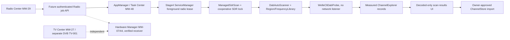

# Stage 8 work package: Automatic DAB+ channel discovery

**Product:** [Tihulu Survival Kit](../../README.md), existing offline-first Pi 5 platform.  
**Planning tracker:** [Stage 8 DAB+ integration epic #3](https://github.com/Tihulu/tihulu-survival-kit/issues/3).  
**Engineering draft:** [SDR PR #2](https://github.com/Tihulu/tihulu-survival-kit/pull/2), based on the existing Stage4/5 feature branch.  
**Status (2026-11-05):** Source-backed plan, synthetic Python modules and a preview UI, **NOT** an operational Pi radio application. The Stage 8 *whole-stage design* remains in review; Stages 1–7 are design-approved. No merge or installation is implied.

## Goal and non-goals

Implement a welle.io-style **one-click, manual, on-demand DAB+ station scanner** inside the existing **Radio Center MW-29**, sharing the physical SDR device, frequency catalog, Region Setup, Channel Explorer, Stage4 optional services, owner-scoped Task Center and existing stored favorite channels. It must work without WAN access or AI inference. Optional audio translation and live subtitles are downstream Stage6 features; not conditions for basic reception.

It is NOT a new tuner application, second channel database, emergency-warning verification service, SDR transmitter, DVB-T2 HD TV decoder, satellite receiver, AI daemon, automatic background scanner or replacement for welle.io. Welle.io is an upstream reference/independent project, not the name of a Tihulu service.

## Receiver and data split

| Resource | Physical receiver | Existing owner | Correct signal/report |
|---|---|---|---|
| FM, DAB+ and supported receive-only SDR protocols | Nooelec NESDR SMArt v5, RTL2832U `0bda:2838`, **SDR-001** | Radio Center / Channel Explorer | Real validated decoder output only |
| DVB-T/T2/C and terrestrial TV/Teletext | Hauppauge WinTV-soloHD 01589, **TV-001** | TV Center / independent DVB backend | HEVC playback and DVB reception on Pi still unverified |
| Country/region/city frequency library | Local installed JSON/opt-in packs | Region Channel Manager | `published_frequency_seed_NOT_received` until measured |
| Favorite/received station records | Owner-scoped SQLite `ChannelStore` | Shared Channel Explorer | Stable receiver + frequency + decoded service ID |
| Optional audio transcription/translation | Shared on-demand Stage6 worker | Language/Subtitle service | Source audio preserved; scan never depends on model |

**Established hardware evidence:** The owner personally validated 2.048 MSPS RTL receive, FM listening in Gqrx, and DAB+ HE-AAC / metadata in welle.io on a **Pop!_OS workstation**. This is not evidence of Pi 5 USB power, ARM64 decoder, reception, or sustained RF worker stability.

## User experience and workflow

1. Open **Radio Center > Automatic DAB+ Scan**: opening the screen is inert; no tuner, subprocess, network request or background job.
2. Select installed region and **Quick** (only published local and national DAB candidates) or **Full** (32 canonical Band III centers, 5A–12D); optionally include **13A–13F** for 38 blocks. Germany/NRW/Köln candidate seeds currently include 5C, 9A, 11D; no assumption that any is receivable. If country/region has no Quick DAB seed (e.g. current TR/İzmir catalog), show the reason and offer Full; do not invent a local DAB transmitter.
3. Explicitly click **Start** after authenticated permission and hardware preflight. The UI creates a server-owned foreground scan job; disable double Start; show current channel/frequency, scanned/total, state, actual decoded multiplex/service count and cancel.
4. Each point retunes the *same* cooperating SDR under a single Stage4 lease and SDR lock. Progress is real task state, not a predetermined animation. Decoder timeout/busy/USB removal become distinguishable error states; cancellation returns honest partial results and a verified stop acknowledgment.
5. Show decoded DAB/DAB+ audio services (ensemble, source frequency/block, decoded ID and label) and separate unsuccessful/partial technical outcomes. SNR, slides and AAC diagnostics appear only when received from a verified decoder.
6. On owner action, import **selected** decoded audio services into the existing ChannelStore; preserve favorites, manually entered unpublished labels and prior user reordering. Do not silently add candidates or erase prior stations.
7. Navigating away or changing clients may release a **view lease**, not a server job. A scan job remains visible/owned in Task Center, with owner-only cancel, cleanup and crash-recovery policy. Never preempt original audio recording or an attached same-tuner listener without a safe user action and recorder flush ACK.

**Basic View:** clear start/stop, region Quick/Full, discoveries, errors and favorites. **Advanced/Expert View:** mux ID/decoder metrics/spectrum/waterfall/constellation/impulse response where actually measured, no fabricated placeholders. Both preserve current compact dark card/window style and existing MW IDs.

## Logical component graph



**Code already present in the draft branch (synthetic-only acceptance):**

| Path | Purpose / current limitation |
|---|---|
| `tihulu_runtime/dab_auto_scan.py` | Quick/full/upper grid, progress, cancel between blocks and selected-service persistence; no Pi field test |
| `tihulu_runtime/sdr_capture.py` | Stage4 foreground lease + cooperating Linux `flock` around entire scan; other programs may ignore flock |
| `tihulu_runtime/welle_cli_probe.py` | Real child-process adapter for source-verified `welle-cli -c/-F/-T/-p`, bounded output/dwell/kill, untrusted source parsing; tested with fake decoder only |
| `tihulu_runtime/welle_local.py` | Read-only expert telemetry reader from an **already isolated** decoder; not a safe process-launch/bind mechanism |
| `tihulu_runtime/channel_explorer.py` | Existing source/mode/status validation and owner SQLite ChannelStore |
| `tihulu_runtime/region_channel_manager.py` | Existing country/region/city candidates and optional packs |
| `data/channel_frequency_presets.json` | Published DAB 5A–12D + opt-in 13A–13F raster with no reception claims |
| `prototype/radio_center.html` | Scan configuration preview; **real Start/Cancel disabled** until authenticated deployment |
| `tests/test_dab_auto_scan.py`, `tests/test_welle_cli_probe.py` | Synthetic end-to-end, fake subprocess, cancel and fail-closed tests |

## Main-project implementation tickets

These IDs appear in [main project tracking issue #3](https://github.com/Tihulu/tihulu-survival-kit/issues/3). Tickets **01/02** have synthetic policy units; **03** has a no-web process prototype but NOT a Pi integration; the rest need additional implementation or real verification.

| Ticket | Deliverable | Dependencies | Release state |
|---|---|---|---|
| SDR-DAB-01 | Source-backed region/frequency plans | Region Catalog / Channel Explorer | Synthetic implemented |
| SDR-DAB-02 | Stage4 lease, tuner single-frequency lock, recorder safety | Service Manager / SDR broker | Synthetic implemented |
| SDR-DAB-03 | Bounded no-web welle-cli service-list decoder | 01, 02 | Synthetic implemented; real decoder pending |
| SDR-DAB-04 | Canonical USB index, hotplug and external-app conflict ownership | Hardware Registry / 02 | Partial single-dongle fail-closed gate |
| SDR-DAB-05 | Authenticated Radio job API, CSRF/idempotency and safe parameters | 02–04 | Not implemented |
| SDR-DAB-06 | Task Center persistence, progress stream, cancel ACK/crash recovery | 05 | Not implemented |
| SDR-DAB-07 | Bind Basic/Expert scan UI to real job state, disable fake controls | 05–06 | Static preview only |
| SDR-DAB-08 | Owner-confirmed save/import UI, dedupe and favorites retention | 01, 03, 05 | Backend synthetic; UI pending |
| SDR-DAB-09 | Actual on-Pi DAB audio, service metadata and expert telemetry | 03–05 | Not physically validated |
| SDR-DAB-10 | Pi5 8GB + SDR-001 + TV-001 + NVMe + hotspot power/thermal/RF test | 04, 05, 09 | Not performed |
| SDR-DAB-11 | Threat model, network isolation, protected original recording recovery | 02, 05, 06, 09 | Partial policy testing |
| SDR-DAB-12 | Full regression, localization/documentation, Stage8 signoff and release | 06–11 | Blocked |

## Required host/service API (DESIGN ONLY; endpoints do NOT exist yet)

The authenticated gateway, once implemented, must expose owner-scoped actions and snapshots along these lines. Route shape and exact schemas require review before implementation:

```text
POST /api/v1/radio/dab/scans
  { receiver_id, region_profile_id, mode: "quick"|"full",
    include_upper_band: boolean, idempotency_key }
  -> { job_id, state: "queued"|"running"|... }

GET  /api/v1/radio/dab/scans/{job_id}
  -> { owner_scope, receiver_id, channel, scanned, total,
       status, discovered_decoded_services, errors, partial }

POST /api/v1/radio/dab/scans/{job_id}/cancel
  -> cancellation_requested, then verified executor ACK

POST /api/v1/radio/dab/scans/{job_id}/save
  { selected_decoded_service_keys, favorite_choice }
  -> existing owner ChannelStore keys
```

Browser may not supply an executable path, raw shell, device index, log text, arbitrary radio mode/frequency or owner ID. No permissions are inferred from client assertions. Use origin/CSRF protections, authenticated session and rate limits, bounded worker counts, receiver/job owner checks, per-job idempotency and no public open web listener.

## Security, low-power and release gates

- **Network:** Verified upstream welle-cli `-w` binds `INADDR_ANY`; therefore never expose the upstream HTTP server to LAN without strong isolation. DAB scanning uses the **no-web** `WelleCliDabProbe` process. The optional `WelleLocalReader` is NOT an authorization boundary.
- **Physical USB:** Upstream `rtl_sdr` frontend opens the first working RTL unit. Existing `UniqueRtlReceiverGate` checks exactly one compatible sysfs path + one `librtlsdr` device; this still is not kernel-enforced exclusive ownership. Multi-device mapping and external-client conflict remain blockers.
- **Low energy:** service Hard/Background/Startup settings retained, scanning on user click only, no auto-start or background timer, no WAN/AI/model cost, bounded per-block 4..40s decoder dwell in current adapter. Long scans may be noticeable; the actual Pi wall time, CPU/memory and battery impact are **not measured**.
- **Originals:** never retune active recording; ensure safe on-disk master recorder flush and verified user action before releasing capture. Do not use received RF metadata to assert an official emergency alert.
- **Truthful statuses:** published seed / USB found / decoder process started / DAB service list decoded / actual audio playable / Pi hardware validated / released are **distinct levels**.
- **Gates:** G0 project traceability; G1 synthetic CI; G2 authenticated app/service ownership; G3 real Pi RF/USB/load/recording trials; G4 full suite + staged design/release signoff.

**Latest isolated code proof:** [SDR CI run 42109969330](https://github.com/Tihulu/tihulu-survival-kit/actions/runs/42109969330) PASS on Python 3.11 + 3.12, 79 synthetic tests **per version** and Radio Center JavaScript syntax. This did not use actual Pi SDR radio reception. The full Stage4/5 workflow was independently failing on `test_unknown_job_counts_fail_closed`; no unconditional CI-green/release claim is allowed.

**Project boundary:** This roadmap is an implementation specification attached to the existing project. It does not approve the full Stage 8 design, merge any branch to `main`, rename existing MW items, publish an image, or assert that users can install a working Tihulu radio application.
